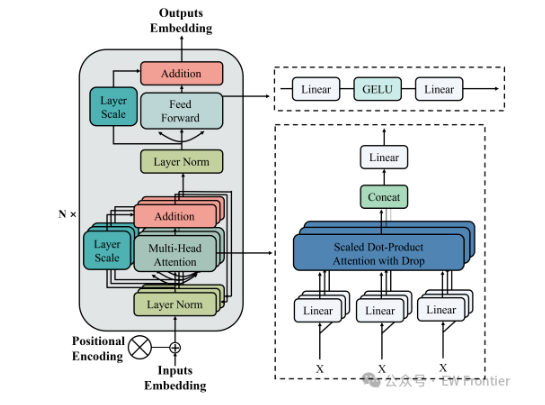
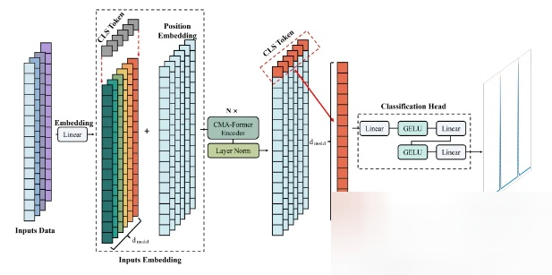
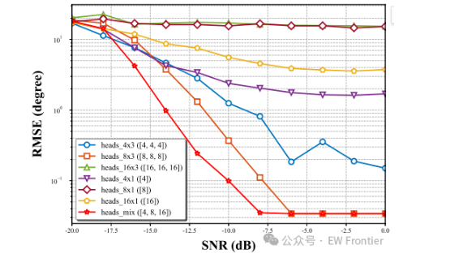
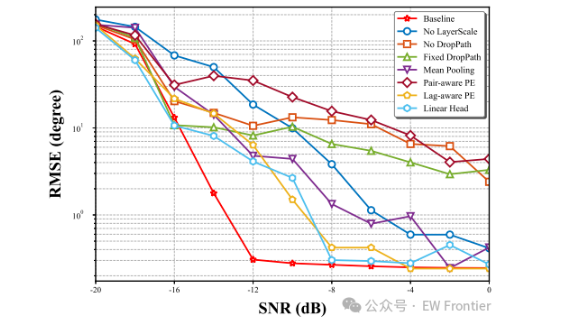
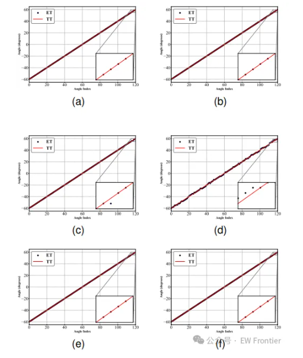

# Music: Directly crashed at -16dB? I used the cascading multi-head attention Transformer for DOA estimation, and the error was reduced to 0.

[EWFrontier · Frontier Radar and Signal Processing]Column: MUSIC Faces a "Schrödinger's Cat" Crisis at -16dB? I Used Cascaded Multi-Head Attention Transformer for DOA Estimation, Bringing Errors Under 0.5° (with Core Code)
Colleagues in array signal processing should have experienced this: In simulations, the MUSIC algorithm is mighty and powerful, but when it comes to real data, it becomes "Schrödinger's cat": low SNR causes spectral peaks to be drowned out by noise, leading to an estimation error of one level, which directly leads to a complete miscalculation. This article will not delve into abstract concepts; instead, we will dive straight into our designed and successfully implemented CMA-Former: a 157 million-parameter cascaded multi-head attention Transformer that, under strong noise conditions of -16dB, achieves an RMSE of only 0.475° for three-source DOA estimation, while MUSIC has degraded to 12.67° under the same conditions.
Firstly, let's address the pain points: Why do traditional algorithms falter at low SNR for direction of arrival (DOA) estimation? It's a core issue in radar, sonar, 5G positioning, and microphone arrays. Traditional methods are mostly based on MUSIC or ESPRIT, with common issues summarized as follows:
1. Reliance on feature decomposition: The covariance matrix of the received signal is decomposed into a signal subspace and a noise subspace. This step is inherently unstable at low SNR;
2. Require prior knowledge of source number: Before searching for spectral peaks in the spectrum of MUSIC, you need to know how many sources are arriving. Source number estimation (AIC/BIC) often fails at low SNR or when there are coherent sources, and once the estimate is wrong, the spectral peak disappears;
3. Model assumptions are strict: Requirements for ideal array elements, non-coherent signals, and sufficient fast-sampling. Engineering issues such as amplitude and phase errors or mutual coupling can lead to a cliff-like drop in performance.
Simply put, the mathematical beauty of classical algorithms is based on ideal assumptions. However, deep learning methods do not care about these assumptions—they directly learn from data to map "signal features → arrival angle" relationships.

2. Rethinking the approach: translating DOA (Direction of Arrival) problems into Transformer's language, our method is straightforward: modeling DOA estimation as a multi-label classification problem.

The angle grid: -60° to 60°, with a step of 1°, totaling 121 classes. Each sample's label is a 121-dimensional vector, where the position corresponding to the arrival angle is 1 (multi-source means multi-label);
Input features: calculate the covariance matrix of received signals, taking only the upper triangular non-diagonal elements—there are 120 complex numbers in a 16-element uniform linear array, each split into 4 dimensions: [real part, imaginary part, sin(phase), cos(phase)].
Why take the upper triangle? Because the covariance matrix is symmetric and lower triangular information is redundant; taking the upper triangle saves computational power while retaining all second-order statistical information. These 120 tokens inherently represent the sequence structure that Transformer needs to consume—the spatial relationship between arrays, which is encoded into the relative positions between tokens through the phase information of the covariance.

3. Three key designs: why it's called "Cascaded Multi-Head Attention" (CMA-Former) The backbone of ViT, but we made targeted design changes at three places:
1. Cascaded Multi-Scale Attention (core innovation) Standard Transformer performs multi-head attention once per block, with a fixed number of heads. We let each block cascade four heads → eight heads → sixteen heads across three attention layers:
class AttentionEncoder(nn.Module):
2. The spatial-phase hybrid representation does not directly embed the real and imaginary parts of complex numbers, but instead incorporates additional sin/cos phase components. The phase is the core carrier of DOA information, explicitly feeding it to the network is equivalent to "highlighting" the model's key points.
3. Engineering details for stable training: LayerScale: Each level of attention output multiplies a learnable scaling factor (initially 1e-4), avoiding initial oscillations in deep network training;
Random Depth (DropPath): Adopts a scheduled mode, with the drop rate linearly increasing with layer depth—conservative at shallow layers, aggressive at deeper ones, stabilizing deep Transformer training;
CLS token pooling: Avoids mean pooling, uses learnable [CLS] tokens to aggregate global information, and the classification head reads directly from them.
IV. Experimental Results: Data doesn't deceive training configuration: 16 elements, λ/2 spacing, SNR from -20dB to 0dB, snapshot 1000, 30 epochs, AdamW (lr=1e-3), BCELoss. Below are the RMSE comparisons between CMA-Former and MUSIC under three source scenarios:
SNR (dB)  
CMA-Former RMSE (°)  
MUSIC RMSE (°)  
-20  
7.06419.492  
-16  
0.47512.667  
-12  
0.2220.747  
-10  
0.1940.333  
0  
0.191  
0.191  
Several highlights:
Low SNR is the main battlefield: At -16dB, MUSIC degrades to 12.7°, essentially guessing blindly (search range 120°, RMSE 12.7° means the spectral peak completely misaligned); CMA-Former still maintains sub-degree accuracy;
Approaching the CRB (CRB): The three-source CRB is approximately 0.889° at -20dB and 0.089° at 0dB. Our model is 0.191° at 0dB, within an order of magnitude of the CRB difference.
Four-source scenario with harsher requirements: -10dB, the RMSE of four-source scene can still be reduced to 0.46°, while traditional methods give up resistance when the number of sources exceeds 3;
Efficiency is impressive: The entire model only has 1.57M parameters, with a single inference time of 1.64ms (V100), and the training memory usage is 1.6GB—a consumer-grade graphics card can run it perfectly.
Designing the number of heads: Don't just wing it. Trying fixed 8-head or 16-head configurations, both yield inferior results compared to [4,8,16] cascading. Fewer heads can't learn phase details at low SNR, while too many can easily overfit noise.
2  
Drop path should be scheduled for: Fixed drop rate training deep networks, where the validation set loss fluctuates significantly; changed to linearly increase with depth, and the convergence curve becomes smooth immediately.
3  
Do not use hard labels: In the early stages, using hard one-hot labels caused frequent oscillations in the model at grid boundaries. Switching to Gaussian soft labels (σ=2°) resulted in smoother prediction spectra and more accurate peak localization.
4  
Inputs should not use the full covariance matrix: instead, use 16×16=256 complex numbers as tokens. This approach reduces the sequence length to half and eliminates redundancy; after taking only the upper triangle, the number of tokens drops to 120, significantly speeding up training while maintaining or even improving accuracy.
VI. Conclusion

## Images

<!-- PAYMENT_BLOCK -->

## Get this dataset

- Payment link (Stripe): [Buy now](https://buy.stripe.com/3cs8yP7sY87d0vu9AB)
- Payment QR code: 

<!-- /PAYMENT_BLOCK -->
